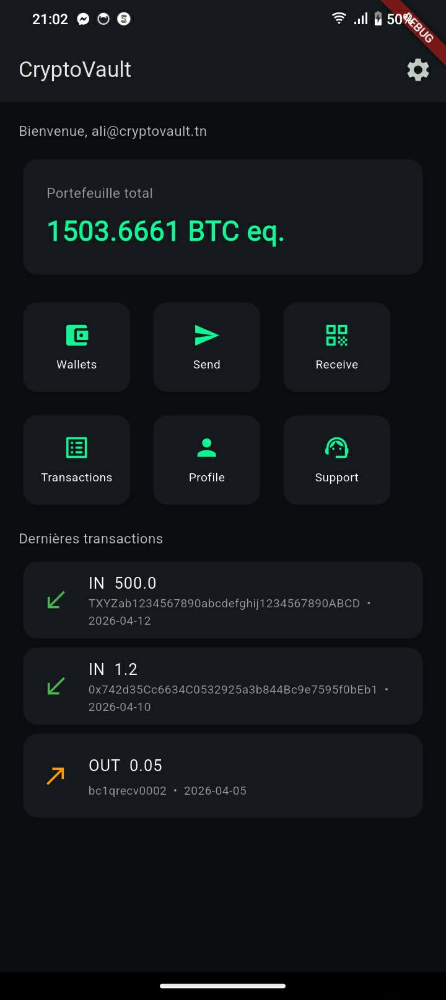
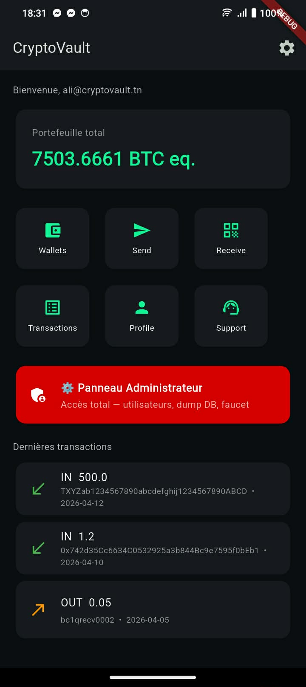
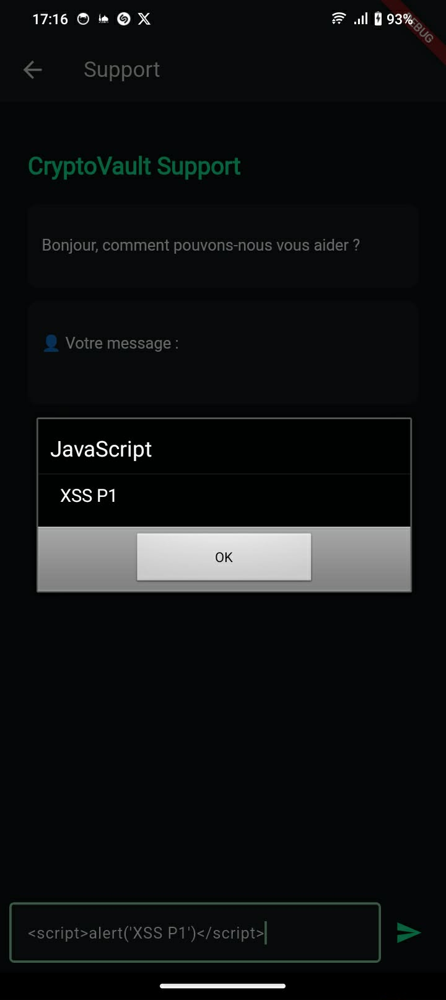
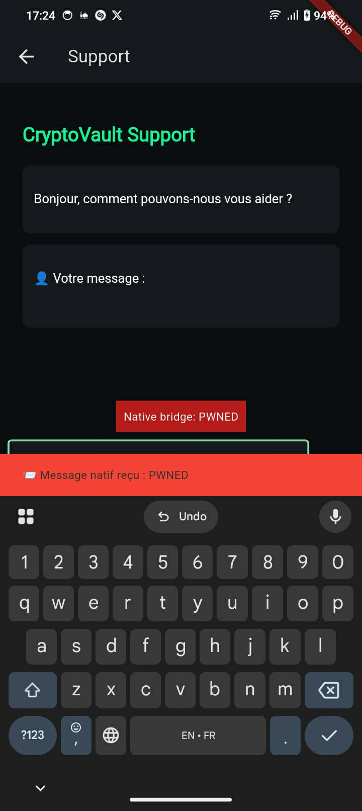
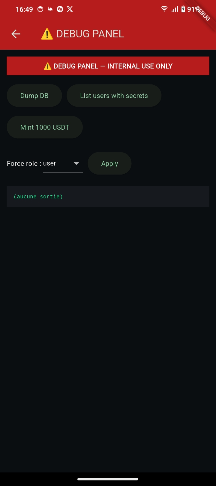
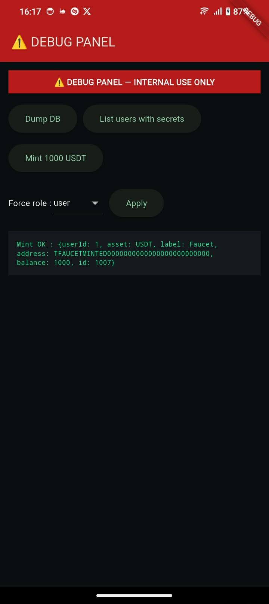
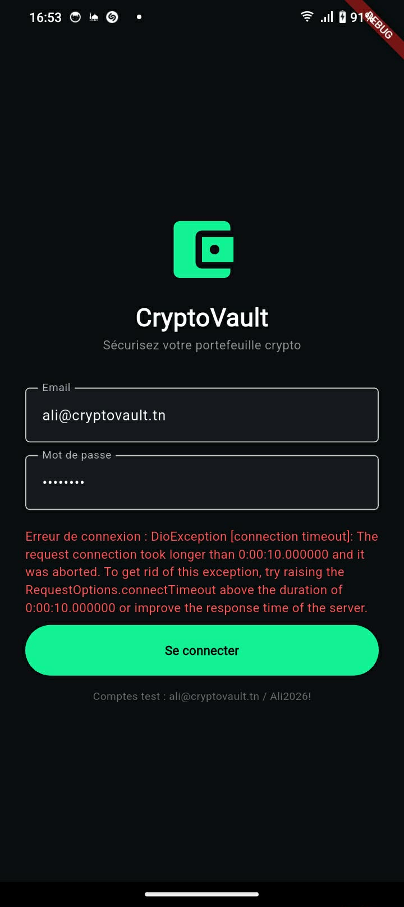
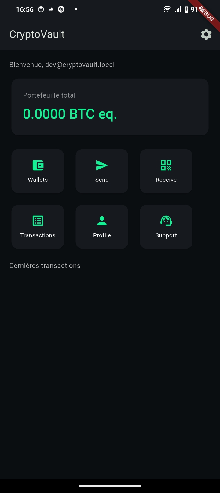

# 🔐 CryptoVault: Mobile Security Audit

**A full OWASP Mobile Top 10 security audit of a deliberately vulnerable Flutter crypto-wallet app for Android, with proof of concept and remediation for every finding.**


> Academic project, *Sécurité des Applications Mobiles*, International Institute of Technology (IIT) Sfax, ARSI, 2025–2026

> ⚠️ **Disclaimer:** CryptoVault is an **intentionally insecure training app**. All credentials, keys and wallet data shown in this repository are fake and were planted for the exercise. Nothing here targets a real service.

---

## Overview

CryptoVault is a Flutter cryptocurrency wallet built with deliberate security flaws. I audited it across the full **OWASP Mobile Top 10**, reproduced every flaw with concrete evidence, then fixed them in a hardened build.

- **15 findings in 10 categories:** 6 critical, 7 high, 2 medium
- **Every finding fixed**, including a full backend rewrite (Express, RS256 JWT, HTTPS with certificate pinning)
- **MobSF security score: 24/100 → 61/100** (+154%)

📄 **Full report:** [CryptoVault_Security_Audit_Report.pdf](report/CryptoVault_Security_Audit_Report.pdf)

---

## Methodology

| Stage | Focus | Tools |
|---|---|---|
| 1 · Static / binary | Secrets, obfuscation, manifest | apktool, strings |
| 2 · Storage | Data at rest, backups | adb run-as, adb backup |
| 3 · Network | TLS, interception, IDOR | Burp Suite |
| 4 · Dynamic | Runtime, WebView, deep links | adb logcat, am |
| 5 · Cryptography | Hashing, encryption, RNG | Python, pycryptodome |

An automated **MobSF v4.5.0** scan was run on both the vulnerable and hardened APKs to cross-check the manual findings.

---

## Findings

| ID | Vulnerability | Severity | OWASP | Fix applied |
|---|---|---|---|---|
| V1 | Hardcoded secrets in the binary | 🔴 Critical | M8 / M9 | Secrets removed, build-time injection, R8 obfuscation |
| V2 | Insecure local storage | 🔴 Critical | M2 | Android Keystore (`flutter_secure_storage`, AES-256-GCM) |
| V3 | TLS validation disabled | 🔴 Critical | M3 | HTTPS + certificate pinning |
| V4 | Sensitive data in logs | 🟠 High | M1 | Sensitive logs removed, release builds strip logging |
| V5a | Client-side JWT role escalation | 🟠 High | M4 | Server-side authorization, RS256 signature checked |
| V5b | Logout doesn't clear the session | 🟠 High | M4 | Server-side token revocation + Keystore wipe |
| V6 | IDOR via sequential IDs | 🟠 High | M6 | User derived from the verified JWT, not the request |
| V7 | WebView XSS with a native bridge | 🟠 High | M7 | JS disabled, bridge removed, escaping + CSP |
| V8 | Insecure Android manifest | 🟠 High | M1 / M8 | 5 dangerous permissions removed, no backup, no cleartext |
| V9a | MD5 PIN hashing | 🟡 Medium | M5 | Argon2id |
| V9b | AES-ECB with a hardcoded key | 🟠 High | M5 | AES-256-GCM, key in Android Keystore |
| V9c | Predictable random numbers | 🟡 Medium | M5 | `Random.secure()` (OS CSPRNG) |
| V10a | Hidden debug panel | 🔴 Critical | M10 | Deep link, route and gesture removed |
| V10b | Hardcoded backdoor account | 🔴 Critical | M10 | Backdoor deleted, CI test blocks its return |
| V10c | Unauthenticated admin endpoints | 🔴 Critical | M10 | Endpoints removed; admin route needs JWT + role + IP allow-list |

---

## Evidence (selected)

| Normal user dashboard | V5a: forged token → admin panel |
|---|---|
|  |  |

| V7: XSS in the support WebView | V7: XSS crosses the native bridge |
|---|---|
|  |  |

| V10a: hidden debug panel, no login | V10c: debug panel mints USDT |
|---|---|
|  |  |

| V10b: backend down, normal login fails | V10b: backdoor account still logs in |
|---|---|
|  |  |

More evidence (strings extraction, storage dumps, Burp interception, logcat, crypto attacks) is in the [full report](report/CryptoVault_Security_Audit_Report.pdf).

---

## Attack chains

Several findings combine into full compromises:

| Chain | Effect |
|---|---|
| V1 → V9b | The AES key extracted from the binary decrypts any stored seed phrase |
| V8 → V2 | `allowBackup` exports the private storage file with the plaintext seed phrase |
| V5a + V5b | A forged admin token is trusted client-side and survives logout |
| V10b + V5a + V1 | The backdoor uses a hardcoded master token that already claims `role: admin` |
| V7 + V4 + V8 | WebView XSS reaches native code; the token is exfiltrated over cleartext |

---

## MobSF before / after

| Dimension | Before (vulnerable) | After (hardened) |
|---|---|---|
| **Security score** | **24 / 100** | **61 / 100** |
| Dangerous permissions | 5 (SMS, Contacts, Call Log, Location, Audio) | 0 (3 normal permissions) |
| Signing | Debug certificate | Dedicated release keystore |
| Min SDK | 24 | 29 |
| Cleartext traffic | Allowed | Forbidden (HTTPS + pinning) |
| allowBackup / debuggable | true / true | false / build-managed |

**Why I stopped at 61/100.** The one remaining HIGH finding is a false positive: MobSF flags an AES-CBC class inside `flutter_secure_storage` that ships with the library but is never executed by the app. Replacing a vetted library with hand-written crypto just to raise the score would make the app *less* secure.

## Lessons learned

- **Automated scans miss a lot.** MobSF found 1 of the 6 hardcoded secrets; a simple `strings` extraction found all 6.
- **MobSF has a Flutter blind spot.** It inspects Java/Kotlin code, but Flutter app logic compiles into `libapp.so`, which its rules don't analyse.
- **Never trust the client.** Most critical findings came from decisions made on the device (role, user ID) instead of the server.

---

## Repository contents

```
cryptovault-mobile-audit/
├── README.md
├── report/
│   └── CryptoVault_Security_Audit_Report.pdf   # full audit report
└── docs/screenshots/                           # proof-of-concept captures
└── remediation/  # hardened client + secured backend
```

The `remediation/` folder contains the hardened Flutter client files and the secured Express backend. Keys and certificates are not included; see the README files in `server/keys` and `server/certs` to generate your own.

## Author

**Firas Trabelsi**, Cybersecurity & Networking engineering student, IIT Sfax
[LinkedIn](https://www.linkedin.com/in/firastrabelsi) · [GitHub](https://github.com/firastrabelsi1412) · Looking for a PFE (2027) in cybersecurity
